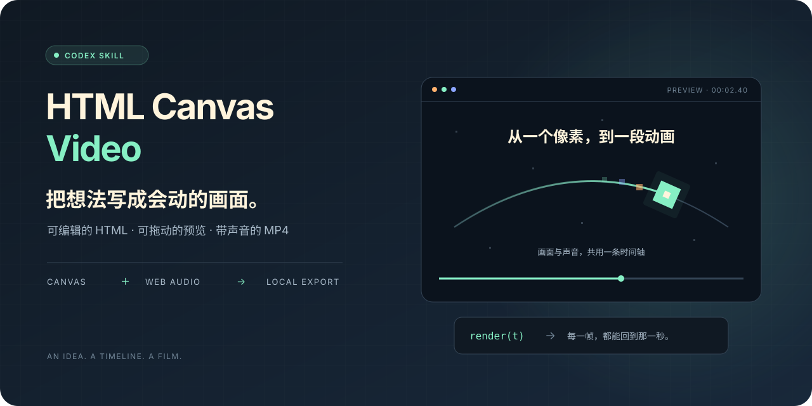
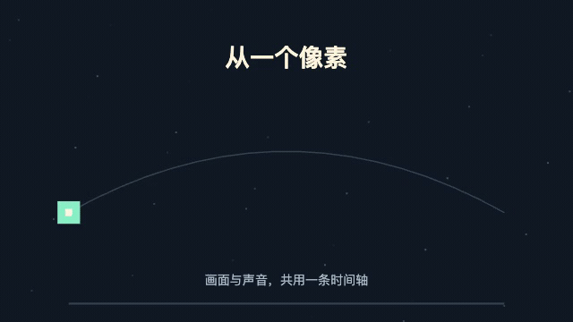

<div align="center">



# HTML Canvas Video

**把想法写成会动的画面。**

用 HTML / Canvas 与程序音频，把一个创意做成可预览、可修改、可导出的动画。

`Codex Skill` · `HTML + Canvas` · `Web Audio` · `Local MP4`

[看演示](#看演示) · [快速上手](#快速上手) · [用 Codex 制作](#用-codex-制作) · [验证范围](#验证范围)

</div>

---

## 从一个像素，到一段动画

这里有一套面向 Codex 的动画制作指导、一份能直接运行的 HTML 模板，以及一个本地 MP4 导出器。故事、画面和声音都在可编辑的工程里：先预览，拖到想改的那一秒，再把结果导出成片。

适合像素剧情、产品小广告、信息图、知识动画、历史时间线、编年史和粒子动效。新作品围绕新主题创作分镜、文案、视觉和声音；现有作品保留已认可的内容和有效工具链。

## 看演示

<div align="center">

<p><sub>横屏 · 640 × 360 · 4 秒 · 当前 starter 的本地 MP4 导出</sub></p>
<details>
<summary>查看竖屏示例</summary>
<br>

<p><sub>竖屏 · 360 × 640 · 3 秒 · 同源 starter 的竖屏验证样片</sub></p>
</details>
</div>

GIF 仅展示画面。模板 MP4 包含程序生成的电子音；在本地打开 HTML，可以试听、暂停和拖动。展示素材均来自原创 starter，不包含用户作品或外部歌曲。

## 能做什么

| 能力 | 你会得到什么 |
| --- | --- |
| **按时间绘制** | `render(t)` 直接计算画面，前后拖动仍回到对应场景；帧导出使用同一函数。 |
| **音画共用时间轴** | Web Audio 生成音轨，预览与导出共用同一缓冲；支持单声道和立体声。 |
| **交互预览** | 播放、暂停、拖动、全屏和静音；自动启声被浏览器拦截时，画面继续，点击即可接入当前进度的声音。 |
| **本地 MP4** | Chrome / Chromium 绘制，FFmpeg 编码 H.264 + AAC；显示帧数、进度与预计剩余时间。 |
| **关键帧先审** | `--stills` 导出指定时刻的 JPEG，方便先检查构图、文字和转折。 |
| **中文字体检查** | 自定义字体按实际中文字形加载，失败会在首帧前报错，帮助发现静默回退。 |

模板不依赖 npm 包或视频生成 API。制作仍需要本机算力；使用 Codex 时也需要你现有的 AI 编程服务。自定义外部字体等资源可能需要联网。

## 快速上手

需要 **Python 3.9+、Chrome 或 Chromium、FFmpeg（含 `libx264` 与 AAC 编码器）**。Python 脚本只使用标准库。以下命令以 macOS / Linux 风格终端为例；本仓库目前只完成了 macOS 实测。

### 1. 下载模板，创建自己的作品副本

在存放工具的目录中执行，选择尚不存在的 `html-canvas-video` 和 `my-first-film` 目录名：

```sh
git clone https://github.com/juew/html-canvas-video.git
cp -R html-canvas-video/assets/starter my-first-film
cd my-first-film
```

此后只修改 `my-first-film`。仓库中的 starter 保留为干净模板。

### 2. 在浏览器预览

用 Chrome / Chromium 打开副本中的 `index.html`。页面准备完成后自动播放；若听不到声音，点击画面启声。

| 操作 | 快捷键 |
| --- | --- |
| 播放 / 暂停 | `Space` |
| 向前 / 向后 5 秒 | `→` / `←` |
| 全屏 | `F` |
| 静音 / 恢复声音 | `M` |

需要 HTTP 预览时，也可以运行：

```sh
python3 -m http.server 8000 --bind 127.0.0.1
```

然后打开 [本地预览](http://127.0.0.1:8000)。端口被占用时换一个端口。

### 3. 导出第一支短片

```sh
# 先导一个小尺寸版本
python3 export_mp4.py --size 640x360 --fps 24 --out review.mp4

# 或只检查指定时刻的画面
python3 export_mp4.py --size 640x360 --stills 0,1.25,3

# 修改完成后，按 HTML 中的画幅与帧率导出
python3 export_mp4.py --out final.mp4
```

`--size` 使用偶数宽高。静帧存放在作品的 `stills/` 中；`--stills` 不生成音轨或 MP4。脚本拒绝覆盖已有成片和同名静帧，重新导出时请选择新文件名或先移动旧文件。

若找不到浏览器，用 `--chrome` 指定实际可执行文件。`--timeout` 默认 **120 秒无进展**，不是影片时长或整个导出的时间上限。详细参数可运行 `python3 export_mp4.py --help` 查看。

## 用 Codex 制作

将整个仓库文件夹安装到你当前 Codex 使用的 Skill 目录中，文件夹名保留为 `html-canvas-video`。常见默认位置是 `~/.codex/skills/html-canvas-video`；已设置 `CODEX_HOME` 时，以当前配置为准。已有同名 Skill 时，先检查内容，不要覆盖安装。

也可以让 Codex 读取本地仓库的 [SKILL.md](SKILL.md)，直接按其中的制作流程开展工作。要使用下面的名称调用，先确认当前会话的可用 Skill 列表中已经出现 `html-canvas-video`；若尚未出现，重新打开会话并检查安装位置。

```text
使用 $html-canvas-video，制作一支 15 秒的竖屏产品小广告。
主题：一盏会提醒我休息的桌面灯。
用温暖的像素风，先展示忙碌，再让灯光提醒，最后落到起身休息。
带原创电子音和简单配乐，不需要旁白。
先给我看开头、转折、结尾静帧，再导出带声音的 MP4。
```

把主题、时长、画幅、风格和声音要求换成你的需求。4 秒只是示例长度；作品时长由 `index.html` 中的 `VIDEO.duration` 决定。

### 自己改代码

- **`VIDEO`**：宽、高、时长、帧率。
- **`render(t)`**：构图、文字、角色、镜头与动作。
- **`makeAudio()`**：音符、节奏和音效；`AUDIO_CHANNELS` 选择 1 或 2 声道。
- **`FONTS`**：自定义字体及实际绘制的文字。使用系统字体时可以留空。

横屏和竖屏需要分别审查排版，尤其是手机上的文字大小。需要旁白时，先生成音频文件再混入时间轴；浏览器的 `speechSynthesis` 不会自动进入导出的 MP4。更多制作经验见 [动画模式参考](references/animation-patterns.md)。

## 从预览到交付

**创意与分镜 → 关键静帧 → 本地预览 → 短试导出 → 完整成片**

画面与声音值得一起检查。建议查看开头、转折、结尾，实际试听，再检查 MP4 的参数与完整解码：

```sh
ffprobe -v error -show_streams -show_format final.mp4
ffmpeg -v error -i final.mp4 -f null -
```

导出成功或解码无误，不代表文案、构图、事实和听感已经通过审查。知识动画应核对来源；外部音乐、字体和素材也应具备相应使用权限。

## 验证范围

| 项目 | 当前状态 |
| --- | --- |
| macOS 本地短片 | 横屏 4 秒、竖屏 3 秒样片已导出并检查；发布前复测当前 starter 的 4 秒 / 640 × 360 / 24 fps 导出。 |
| 较长片段 | 62 秒、1920 × 1080、60 fps、3720 帧、48 kHz 立体声已完成导出与完整解码。这是能力验证，不是渲染速度基准。 |
| 交互与边界 | 已检查播放与拖动、自动启声受限后的恢复、字体加载、立体声、导出进度、停滞处理及异常清理。 |
| 尚未验证 | 4–5 分钟完整片、Windows / Linux 完整流程、全片主观试听。 |

时长、分辨率、画面复杂度与本机资源都会影响导出耗时和内存。模板会先生成整段音轨；更长或更复杂的作品应先做短试导出。

## 仓库内容

```text
html-canvas-video/
├── SKILL.md                      # Codex 制作流程
├── agents/openai.yaml            # Skill 显示与调用信息
├── assets/starter/
│   ├── index.html                # 可编辑画面、音轨与预览
│   └── export_mp4.py             # 本地导出器
├── references/animation-patterns.md
└── docs/assets/                  # 本页展示素材
```

这是独立维护的社区项目，与 OpenAI 无官方隶属或背书关系。仓库暂未指定开源许可证；公开可见不等于已授予开源使用许可。
